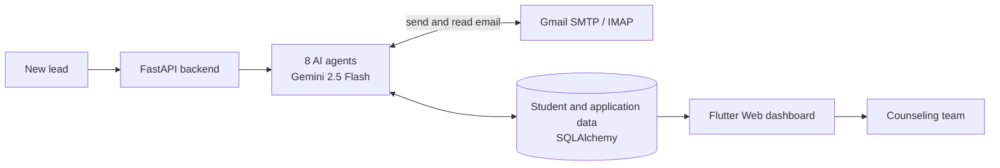

# Admitly: AI Lead-to-Admission System

**8 AI agents running the student journey across 13 automated stages, from first inquiry to post-arrival follow-up.**

Client: the same study-abroad consultancy as the [AI Study-Abroad Counselor](study-abroad-ai-counselor.md).
Role: forward deployed AI engineer at the consultancy.
Status: in final testing before launch.

> This is a case study. The code and data belong to the client, so they are not published here.

## The problem

Once a student became a lead, counselors handled everything by hand: collecting documents, managing applications, sending messages and chasing follow-ups. Each student went through many steps, and keeping track of all of them across a growing number of students took most of the team's time.

## What I built

- **An 8-agent system** that moves each student through 13 automated stages, from the first inquiry to follow-ups after the student arrives
- **Email automation** over Gmail (SMTP and IMAP), so agents can send messages and pick up replies
- **A dashboard** where the team monitors every student, manages applications and sees where each student is in the process

## Architecture

Deployment: backend in Docker on AWS App Runner (images in ECR), dashboard on AWS Amplify.

## Stack

Google Gemini 2.5 Flash · FastAPI · SQLAlchemy · Gmail SMTP/IMAP · Flutter Web · AWS ECR · App Runner · Amplify · Docker
