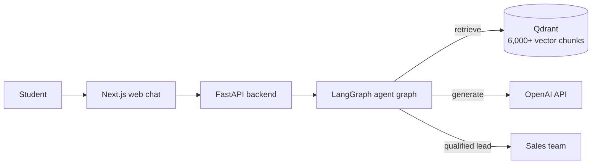

# AI Study-Abroad Counselor

**Multi-agent RAG system, live in production, serving students across 23 countries.**

Client: a study-abroad consultancy with offices in Pakistan, the UK and the UAE.
Role: forward deployed AI engineer at the consultancy.

> This is a case study. The code and data belong to the client, so they are not published here.

## The problem

Counselors spent hours every day answering the same first questions from students: which universities fit, which destinations, what scholarships exist, what it costs. These came in through calls and office visits, so the team's time went on repeat answers instead of on students who were ready to apply.

## What I did

I worked directly with the founder and the counseling team to see how inquiries actually came in and where the time went. Then I designed and built a multi-agent AI counselor that:

- answers a student's first questions from the consultancy's own knowledge, not from the model's general knowledge
- retrieves the right information on universities, destinations, scholarships and budgets
- qualifies the student as a lead and passes qualified leads to the sales team

## Architecture

Deployment: Docker containers on AWS EC2 behind Caddy, with GitHub Actions for CI/CD.

## Result

- Live in production
- Serving students across 23 countries
- First inquiries are answered by the AI counselor, and the sales team receives qualified leads instead of every raw inquiry

## Stack

LangGraph · RAG · Qdrant · OpenAI API · FastAPI · Next.js · AWS EC2 · Docker · Caddy · GitHub Actions

## Next

The same client's admission process is the next step: see [Admitly](admitly.md).
